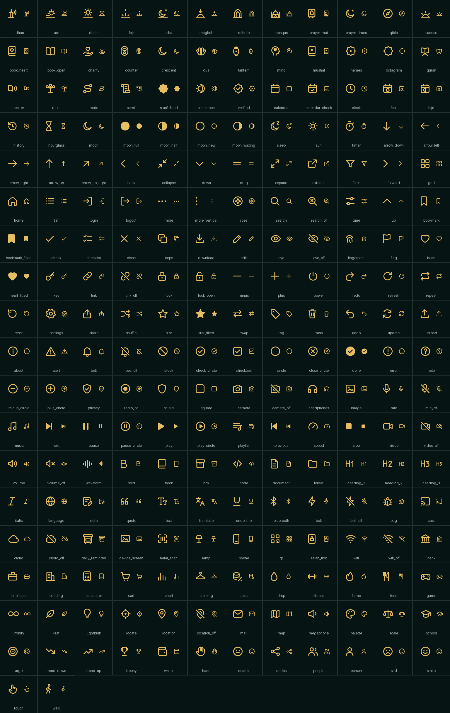

# Sahibukum Icons

One drawn icon set for Muslim apps: the prayer day from Fajr to Isha, the Qur'an, dua and dhikr, the Hijri
month, zakat and the masjid, and the everyday interface icons around them, all drawn in one hand. Sahibukum
uses it in its app, on its website and on The Daily Reminder; anyone may use it under
[CC BY 4.0](#licence).

Browse, search and download: **https://sahibukum.com/developers/icons**



## Licence

The icons (`icons/` and everything in `dist/` built from them) are licensed under the
[Creative Commons Attribution 4.0 International licence](https://creativecommons.org/licenses/by/4.0/)
(`LICENSE-ICONS.txt`). You may use them in any project, free or paid, and change them, as long as you
give credit. The build scripts in `tools/` are MIT (`LICENSE`).

**How to credit.** Put this line where you credit other work (an About screen, a site footer, a README):

> Icons by [Sahibukum](https://sahibukum.com/developers/icons), CC BY 4.0

If you changed an icon, say so: "Icons adapted from Sahibukum Icons, CC BY 4.0".

**What the licence does not cover.** The Sahibukum name and logo (the girih S) are trademarks of
Sahibukum Pte. Ltd. and are not part of this set. Do not use them, or suggest that Sahibukum made or
endorses your product.

## Using the icons

Every format is in `dist/`, built from `icons/` and committed, so nothing needs to be built to use them.

| Format | File | Use |
|---|---|---|
| SVG, one per icon | `dist/svg/<name>.svg` | Any design tool or page. Filled outlines in `currentColor`. |
| SVG sprite | `dist/sahibukum-icons.svg` | `<svg width="24" height="24"><use href="sahibukum-icons.svg#mosque"/></svg>` |
| Web font | `dist/SahibukumIcons.woff2` | `@font-face` with the codepoints in `dist/icons.json` |
| Font | `dist/SahibukumIcons.ttf` | Flutter, LVGL, native apps |
| Flutter | `dist/sahibukum_icons.dart` | `Icon(SahibukumIcons.mosque)` with the TTF as font family `SahibukumIcons` |
| Catalogue | `dist/icons.json` | Name, title, category, tags, codepoint, mirroring, outline path |

Source SVGs in `icons/` are strokes (1.75 px). Use them to edit an icon; use `dist/svg/` to ship one, since
it keeps its weight at any size without a stroke setting.

**Right to left.** Icons that point along the reading direction (back, forward, the arrows, undo, lists)
are listed as `mirrored` in `icons.json`: flip them in Arabic, Urdu and other right-to-left layouts. The
Flutter class sets `matchTextDirection` for them.

**Sizes.** Drawn for 24 px; good from 16 px up. Keep them on whole pixels.

## Drawing an icon

1. 24 x 24 grid, a 2 px clear margin (the live area is 20 x 20).
2. One line: 1.75 px, round ends, round corners. Containers 16.5 px with a 3 to 3.5 px corner; rings
   r 8.75.
3. Open shapes. Fill only for play controls, small dots, and the filled twin of an outline icon (a saved
   bookmark, a liked heart), which is drawn the same size (`class="solid"`).
4. An "off" icon is the icon with a slash from top left to bottom right, its gap cut out (`class="cut"`
   under `class="over"`).
5. Islamic ideas are drawn from their objects and their geometry: the crescent and star, the dome and the
   mihrab arch, the open book on its stand, the eight-point star, the scroll, the lantern, the five times of
   prayer on one horizon. No people at prayer, no faces, and no likeness of a real holy place (the Ka'bah,
   the Prophet's Mosque).
6. One icon per idea. Check the set before drawing a new one.

Add the SVG to `icons/`, give it an entry in `icons.meta.json` (title, category, tags), run the build and
look at `dist/contact-sheet.png` at 24 px before committing:

```sh
python3 -m venv .venv && .venv/bin/pip install -r tools/requirements.txt
.venv/bin/python tools/build.py
```

`codepoints.json` only grows: a name keeps its codepoint, so fonts stay compatible between versions.
Renaming or removing an icon is a breaking change (a new major version).

## Where Sahibukum uses it

- The app (`sahibukum_flutter`): `dist/SahibukumIcons.ttf` and `dist/sahibukum_icons.dart`.
- The website (`sahibukum-web-apps`): `dist/svg` and the sprite, and the developer page.
- The Daily Reminder (`sahibukum-adhan-clock`): the firmware rasterises `dist/svg` for its screen.

Copyright 2026 Sahibukum Pte. Ltd.
